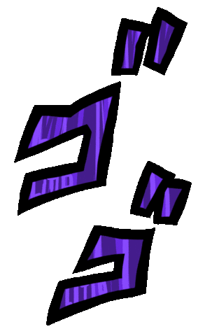
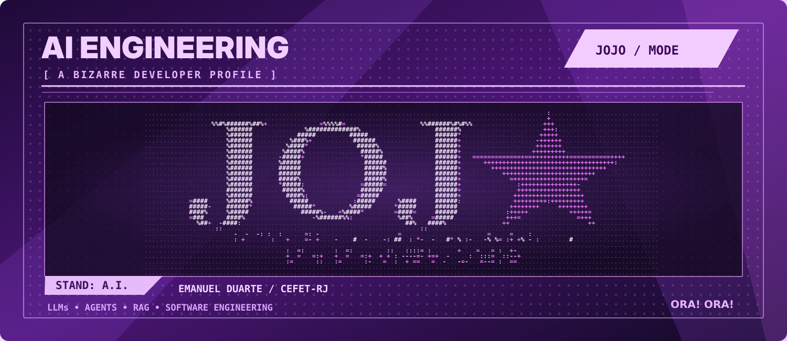

  

  

--- 

  

I'm **Emanuel Duarte**, an **AI Engineering Intern at IPNET by Vivo** and **Information Systems student at CEFET-RJ**.

My work and projects explore **LLM-powered applications, AI agents, RAG architectures and software development**. I'm also studying **Machine Learning, Deep Learning, model training and explainable AI**.

  
  
  

  

---

  

  Dark purple: applied in projects · Light purple: studied &amp; explored

### 🤖 AI Agents & LLM Engineering

**Applied in Projects**

  
  
  
  
  

**Studied & Explored**

  
  
  
  
  

### 📚 RAG, NLP & Vector Databases

**Applied in Projects**

  
  
  

**Studied & Explored**

  
  

### 🧠 Machine Learning & Deep Learning

**Studied & Explored**

  
  
  
  
  

### 📊 Data Science & Visualization

**Applied in Projects**

  
  

**Studied & Explored**

  
  
  
  

### 🚀 AI Applications & Backend Development

  
  

<strong>More technologies</strong>

### ⚙️ Additional Frameworks & Libraries

  
  
  
  
  

### 💻 Programming Languages

  
  
  
  
  
  
  
  

### 🗄️ Databases

  
  
  

### 🛠️ Development Tools

  
  
  
  
  
  
  

 

---

  

  
  

 

---

<picture>
  <source media="(prefers-color-scheme: dark)" srcset="https://raw.githubusercontent.com/Manudrel/Manudrel/output/github-contribution-grid-snake-dark.svg">
  <source media="(prefers-color-scheme: light)" srcset="https://raw.githubusercontent.com/Manudrel/Manudrel/output/github-contribution-grid-snake.svg">
  
</picture>
 
